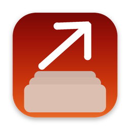
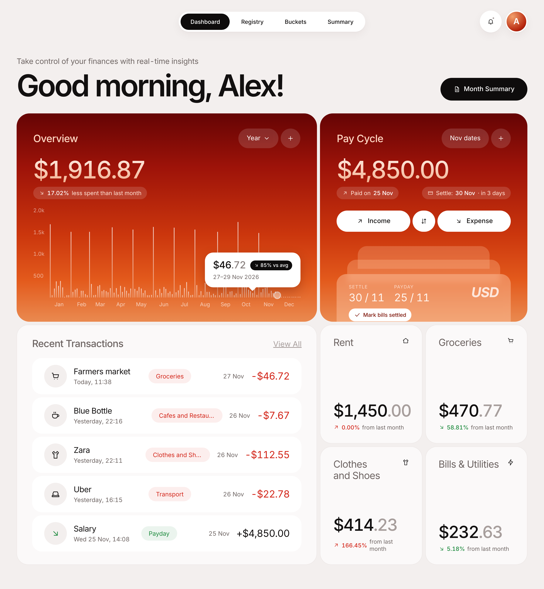
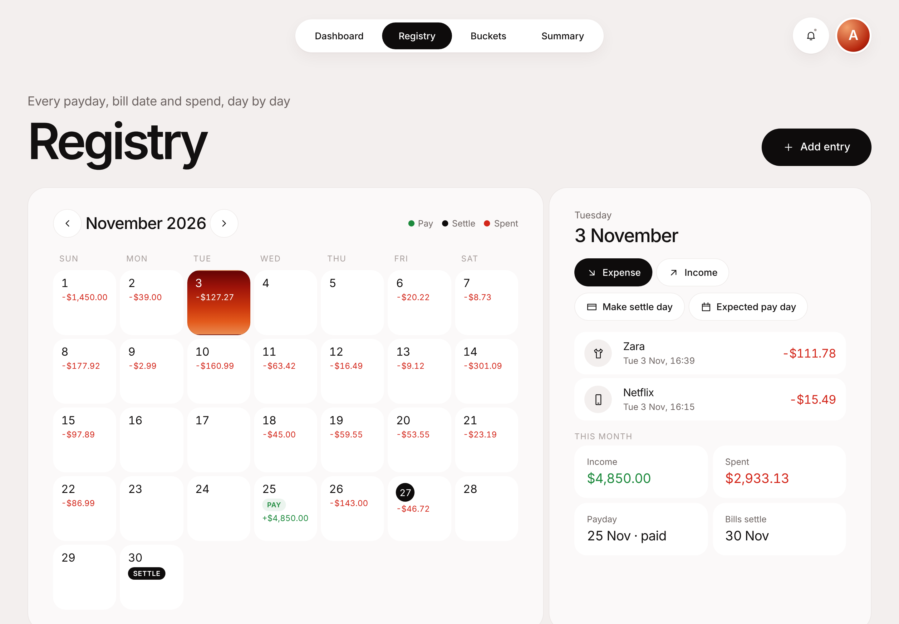
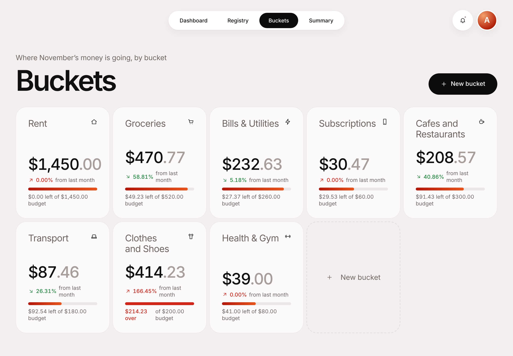
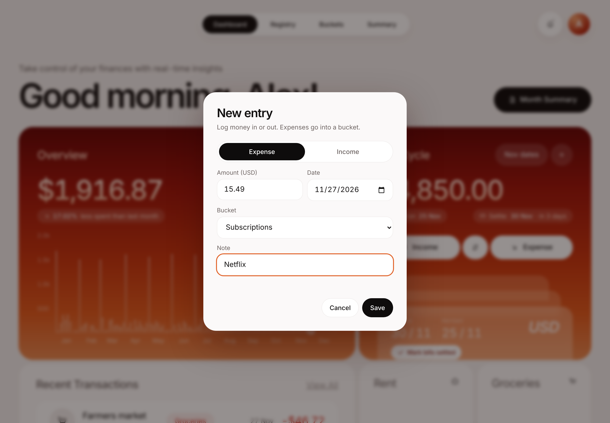
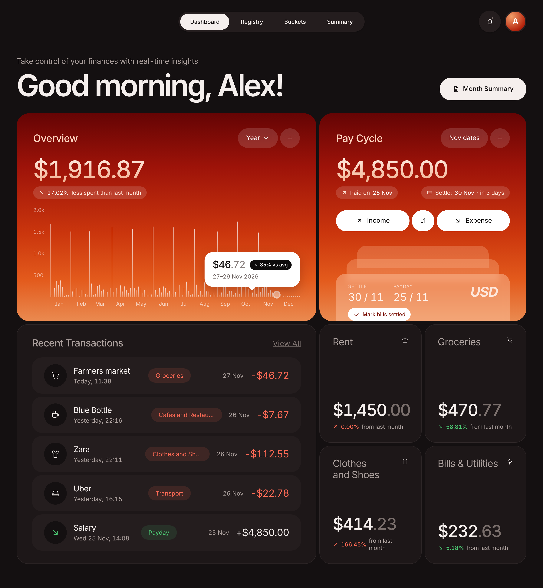
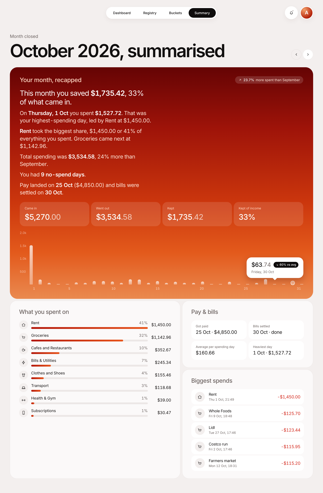

<div align="center">



# PayDay

### Know where your money went before the month is over.

A calm little money tracker for **macOS and Windows**. Register when you got paid, pick the day you settle your bills, drop every spend into a bucket, and get a plain-English recap when the month closes.

*No bank login. No cloud. No subscription. Just your numbers, on your own computer.*

<br>



<br>

[**Download**](#-install) · [Features](#-what-it-does) · [Screenshots](#-a-quick-tour) · [First five minutes](#-your-first-five-minutes) · [Your data](#-where-your-data-lives) · [Build it yourself](#-build-it-yourself)


</div>

---

## 💡 Why this exists

Most budgeting apps want you to connect your bank, sync to a server and pay every month for the privilege. Then they bury the one thing you actually care about under twenty charts.

My month runs on two dates: the day the salary lands and the day the bills go out. Everything in between is either groceries, a coffee, an Uber or something I'll regret. I wanted an app that's built around that rhythm, looks good enough that I actually open it, and keeps everything on my own machine.

So I built it. Then I figured other people might want it too, so here it is, free and open source.

> You shouldn't need a finance degree or a bank integration to know whether you saved money this month.

---

## ✨ What it does

- 👋 **A dashboard that greets you.** "Good morning, Alex." Your balance for the month, a full year of spending at a glance and your latest transactions, all on one screen.
- 💸 **Pay cycle tracking.** Register the day you got paid, set the date you'll settle your bills, and see a countdown until they're due. Tick them off when they're paid.
- 🗓️ **A real calendar.** The Registry shows every payday, settle day and spend, day by day. Click any date to see what happened or add something you forgot.
- 🪣 **Buckets for everything.** Rent, Groceries, Subscriptions, Cafes, whatever fits your life. Pick an icon, set an optional monthly budget and watch the bar fill up.
- 📝 **A month-end recap that reads like a person wrote it.** "On Thursday, 1 Oct you spent $1,527.72. That was your highest-spending day." What you saved, which bucket ate the most, how it compares with last month and how many no-spend days you had.
- 🌍 **Every currency.** All 160+ world currencies, each with its own symbol and the right number of decimals. Bahraini dinar gets three, Japanese yen gets none.
- 🌙 **Light and dark mode** that follow your system setting.
- 🔒 **Private by default.** No account, no server, no analytics. Your data is a single file on your computer, with automatic backups.

---

## 📸 A quick tour

<table>
<tr>
<td width="50%" valign="top">

**Registry**<br>
Every day of the month in one view. Paydays, settle days and spending are marked right on the calendar.



</td>
<td width="50%" valign="top">

**Buckets**<br>
See where the money is going this month, with budgets and a comparison to last month.



</td>
</tr>
<tr>
<td width="50%" valign="top">

**Adding a spend**<br>
Amount, date, bucket, note. Done in a few seconds.



</td>
<td width="50%" valign="top">

**Dark mode**<br>
Same app, easier on the eyes at night.



</td>
</tr>
</table>

**The month-end recap**



<sub>All screenshots use made-up demo data.</sub>

---

## 📦 Install

Head to the [Releases](../../releases) page and grab the file for your computer.

### 🍎 Mac

1. Download **`PayDay_x.y.z_universal.dmg`**. It runs natively on both Apple Silicon and Intel Macs.
2. Open it and drag **PayDay** into **Applications**.
3. **First launch only:** PayDay isn't notarized by Apple yet, so right-click the app, choose **Open**, then click **Open** again. After that it opens normally.

If macOS still says the app is damaged, run this once in Terminal:

```bash
xattr -cr /Applications/PayDay.app
```

### 🪟 Windows

1. Download **`PayDay_x.y.z_x64-setup.exe`**. Prefer an MSI for managed PCs? There's a `.msi` next to it.
2. Run it. It installs just for you, so no admin password is needed.
3. **First launch only:** the installer isn't code-signed yet, so Windows SmartScreen may show "Windows protected your PC". Click **More info**, then **Run anyway**.

PayDay uses Microsoft Edge WebView2, which is already on Windows 10 and 11. If it's somehow missing, the installer fetches it for you.

---

## ⏱️ Your first five minutes

1. **Say hi.** Type your name and pick your currency. That's the whole sign-up.
2. **Set this month's dates.** Click the dates button on the Pay Cycle card (it reads **Nov dates** in November) and choose your bill-settle date and your expected payday.
3. **Register your pay.** Hit **+** on the Pay Cycle card when your salary lands. It shows up as a green **Pay** tag on the calendar.
4. **Log a few spends.** Hit **Expense**, type the amount and choose a bucket. Netflix goes in Subscriptions, the Friday takeaway goes in Cafes.
5. **Make it yours.** Open **Buckets**, add your own and give the important ones a budget.
6. **Come back at the end of the month.** A banner points you to the **Summary**, where your recap is waiting.

---

## 🗄️ Where your data lives

Everything is stored in one plain JSON file:

| | Location |
| --- | --- |
| **Mac** | `~/Library/Application Support/app.payday.tracker/payday.json` |
| **Windows** | `%APPDATA%\app.payday.tracker\payday.json` |

PayDay is careful with that file:

| Safety net | What it does |
| --- | --- |
| **Safe writes** | Every save goes to a temporary file first and is then swapped in, so a crash or power cut can't leave a half-written file. |
| **Previous version** | The last good copy is always kept as `payday.prev.json`. If the main file is ever damaged, PayDay quietly loads that instead. |
| **Daily copies** | One snapshot per day for the last 30 days, in the `backups/` folder. |
| **Your own backups** | Click your avatar, then **Back up to Downloads**. **Restore backup** loads one back in. |

Time Machine on a Mac, or File History on Windows, picks all of this up too. Nothing ever leaves your computer.

---

## 🛠️ Build it yourself

You'll need **Node.js 18+** ([nodejs.org](https://nodejs.org)) and **Rust** ([rustup.rs](https://rustup.rs)), plus:

- **Mac:** Xcode Command Line Tools, installed with `xcode-select --install`
- **Windows:** [Visual Studio Build Tools](https://visualstudio.microsoft.com/visual-cpp-build-tools/) with the "Desktop development with C++" workload

Then:

```bash
git clone https://github.com/iamuwan/payday.git
cd payday
npm install
npm run dev      # run it in a window while you hack on it
npm run build    # Mac: PayDay.app + .dmg · Windows: setup .exe + .msi
```

You'll find the build output in `src-tauri/target/release/bundle/`.

On a Mac, to build one app that runs on both Apple Silicon and Intel:

```bash
rustup target add aarch64-apple-darwin x86_64-apple-darwin
npm run build:universal
```

### Releasing

`.github/workflows/release.yml` builds the Mac `.dmg` and the Windows installers side by side on GitHub's own machines. Push a tag and it drafts one release with all of them attached:

```bash
git tag v1.0.0 && git push origin v1.0.0
```

You can also run **Build PayDay** by hand from the **Actions** tab.

---

## 🔧 Under the hood

PayDay is deliberately small.

- **The interface is one file.** `src/index.html` holds the HTML, CSS and JavaScript. There's no framework and no bundler. Open it in a browser and it runs, saving to the browser's storage instead of a file, which makes design tweaks quick.
- **The native side is about 130 lines of Rust** in `src-tauri/src/lib.rs`. It handles loading, saving, backups and exporting. Nothing else.
- **[Tauri 2](https://tauri.app)** turns it into a proper desktop app of around 10 MB. It uses the web engine your system already has, WebKit on macOS and WebView2 on Windows, instead of shipping a whole browser.
- **Numbers and currencies** come from the built-in `Intl` APIs, so every currency formats the way people expect.

```
src/index.html              the whole interface
src-tauri/src/lib.rs        load, save, daily backups, export
src-tauri/tauri.conf.json   window, name, icon and bundle settings
src-tauri/capabilities/     what the window is allowed to do
src-tauri/icons/            app icons (generated from app-icon.png)
docs/screenshots/           the images in this README
```

To change the icon, swap `src-tauri/app-icon.png` for any 1024×1024 PNG and run `npx tauri icon src-tauri/app-icon.png`.

---

## 🗺️ Ideas for later

- [ ] Recurring entries (rent, Netflix and Spotify fill themselves in)
- [ ] CSV import from bank statements
- [ ] Sync between your computers through iCloud Drive or OneDrive
- [ ] Quick-add from the menu bar (Mac) or system tray (Windows)
- [ ] Phone companion

Got something you'd use? Open an issue.

---

## 🤝 Contributing

Pull requests are welcome, big or small. A couple of house rules:

- Keep `src/index.html` dependency-free. If it needs `npm install` to run in a browser, it doesn't belong there.
- Data stays on the user's device. No analytics, no telemetry, no "optional" cloud.

Found a bug? Open an issue with what you did, what you expected and a screenshot if you can.

---

## 📄 License

[MIT](LICENSE) © 2026 Uwan Perera. Use it, fork it, sell a better version of it. Just keep the licence file.

<div align="center">
<br>
<sub>Made by Uwan Perera in Bahrain, for anyone who's ever wondered where the salary went.</sub>
</div>
